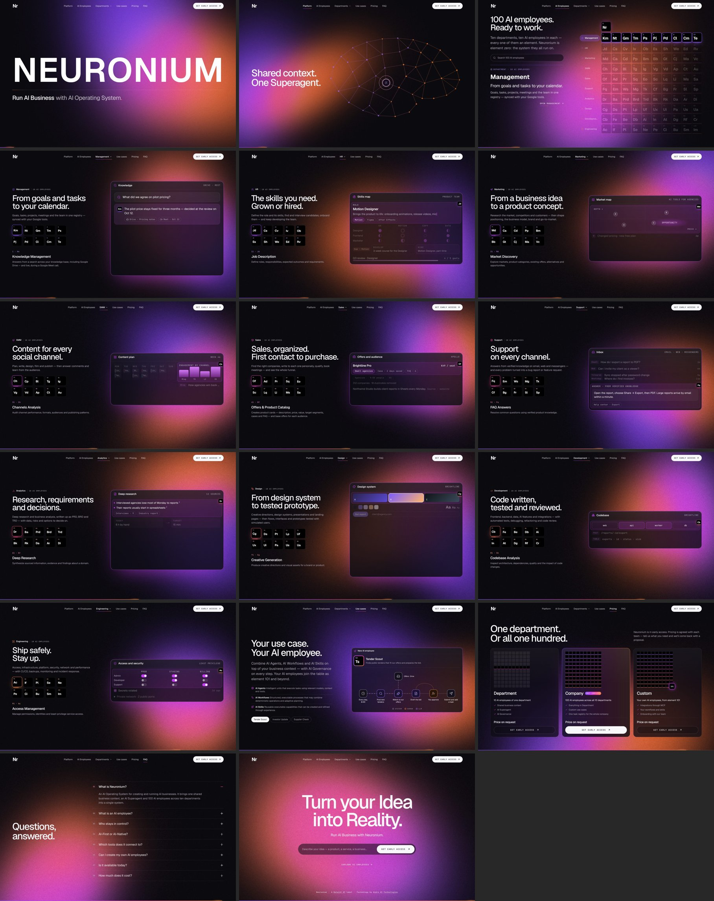

# Neuronium — Run AI Business with AI Operating System.

Interactive landing for **Neuronium**, the AI Operating System by Andre AI Technologies (a Dataist AI label).
Full-screen blocks, one gesture per block, over one continuous WebGL light field.
100 ready AI employees are shown as elements of a periodic table; Neuronium is element 0 (**Nr**).

The site opens step by step. **Open now:** the hero, Platform (the AI Superagent in your business context),
Management with its first AI employee (**1 · Km**, Knowledge Management), Pricing, FAQ and the final
block. Pricing and FAQ describe what is ready today. The other 11 blocks are built and stay hidden
until they are opened — see [Staged release](#staged-release).



## Run it

```bash
npm install
npm run dev          # http://localhost:5173
npm run build        # type-check + production build → dist/
npm run preview      # serve dist/ at http://localhost:4173
```

Requires Node 20.19+ or 22.12+. The build is a static site (`dist/`) and can be hosted anywhere.

### Connection points (no fake sign-ups)

There is no registration backend in this project, so nothing pretends to submit:

| Variable | Used by | Default |
|---|---|---|
| `VITE_EARLY_ACCESS_URL` | “Get Early Access” buttons | `mailto:admin@andre.technology` (published on andre.technology) |
| `VITE_IDEA_ENDPOINT` | The idea input on the last block (“Run Your AI Business”) | empty → opens a pre-filled email with the idea; when set → `POST {"idea","source"}` JSON |

Copy `.env.example` to `.env` to set them. See `src/config/links.ts`.

## Staged release

What is open is set in one file, [`src/data/release.ts`](src/data/release.ts):

| Setting | Opens | Now |
|---|---|---|
| `OPEN_EMPLOYEES` | AI employees by number (1–100). A department block opens as soon as one of its AI employees is open and shows only its open elements. | `[1]` — Management with 1 · Km |
| `OPEN_BLOCKS.employees` | The periodic table of 100 AI employees | `false` |
| `OPEN_BLOCKS.custom` | Use cases | `false` |
| `OPEN_BLOCKS.pricing` | Pricing | `true` |
| `OPEN_BLOCKS.faq` | FAQ | `true` |

Until all 100 AI employees are open, Pricing and FAQ describe what is ready:

- **Pricing** shows one subscription: “One AI employee today. A hundred to come.” Its small periodic table
  lights only the open elements, and it lists them (now 1 · Km Knowledge Management) with the shared
  business context and the AI Superagent. Price on request.
- **FAQ** gives the answers for today, for example “Ready today: Knowledge Management. New AI employees are
  added one by one.” It leaves out questions about closed blocks, such as creating your own AI employees.
- Both follow `release.ts` on their own: open another AI employee and it appears in the subscription and
  the answers. The three plans and the full answers (`src/data/pricing.ts`, `src/data/faq.ts`) come back
  once all 100 are open.

A department with only one open AI employee is led by it. Now that is Management with 1 · Km:
- On the left: the title “AI Knowledge Management”, then “Get answers with the full business context—powered by your
  Corporate World Model.”, then its element. The line under the element fills up until the next answer.
- On the right, no window — just a search bar at the bottom. A question is typed into it and sent, and above it the
  answer streams in with the three things it was found in, each just an icon and a name
  (`src/slides/Department/panels/knowledge.tsx`).
- Once a second AI employee of the department opens, the department's headline, its elements and its turning
  interface come back.

The hero, Platform and the final block are always open. A closed block is not rendered at all:
it is not in the menu, scrolling skips it, and a link to it (`#sales`) does nothing. Links that would
lead to a closed block are hidden too — “Explore AI Employees” on the final block, “Open Sales” in the
table. With one department open, the menu links to it directly; with more, they share the Departments
dropdown.

To open Note Taking (2) next, and then the table:

```ts
export const OPEN_EMPLOYEES: readonly number[] = [1, 2]
export const OPEN_BLOCKS = { employees: true, custom: false, pricing: false, faq: false }
```

The checks read the same file: they test what is open and check that everything else is absent.

## Checks

```bash
npm run validate:data      # 100 AI employees: names, order, numbering, unique element symbols
npm run validate:browser   # every open block × 7 viewports + functional checks (menu, departments, forms, touch…)
npm run simulate           # simulated visitors: trackpad/desktop, phone with swipes, keyboard only
```

The browser scripts need Playwright with Chromium (`npm i -D playwright && npx playwright install chromium`)
and a running `npm run preview` (override the URL with `BASE_URL=…`). Output goes to `validation/`.

Latest results for the staged release (production build, headless Chromium with software WebGL):

- **Data**: 10 departments × 10 = 100 AI employees (elements 1–100), with exact names, order and unique element symbols.
- **Browser**: **32 / 32 checks passed** at 1920×1080, 1440×900, 1280×800, 1024×768, 768×1024, 390×844 and 375×667.
  - Every open block fits without inner scroll, with no horizontal overflow, cut headline lines or truncated panel titles, and no JavaScript errors.
  - Only the open blocks are on the page; the menu shows Platform · Management · Pricing · FAQ; links to closed blocks do nothing.
  - Knowledge Management answers one question after another, each with its sources and the documents it was found in.
  - Pricing shows one subscription that lights only the open elements; the FAQ names what is ready today. [Report](docs/validation/browser-report.md)
- **Simulated users**: **31 / 31 steps** behaved as expected for a desktop trackpad visitor, a phone visitor with swipes and a keyboard-only visitor. One trackpad flick always turns exactly one block, even while the page is busy. [Walkthrough with screenshots](docs/validation/user-walkthrough.md)
- With everything opened in `release.ts`, the same scripts run the full tour of all 17 blocks (last run: 66 / 66 walkthrough steps).

Screenshots: [desktop](docs/screenshots/desktop-1440x900), [phone](docs/screenshots/phone-390x844),
contact sheets for all seven viewports in [docs/screenshots/sheets](docs/screenshots/sheets), and
[reduced motion](docs/screenshots/reduced-motion-management.jpg).

## The 17 blocks

Built and in the code; open now: 01, 02, 04 (1 · Km on its own), 15 and 16 (for what is ready) and 17.

| # | Block | What it shows |
|---|---|---|
| 01 | Hero | **NEURONIUM** · “Run AI Business with AI Operating System.” |
| 02 | AI Superagent works in the context of your business | A brain-shaped graph whose nodes are the tools — Gmail, Calendar, Meet, Slack, Telegram, WhatsApp, Drive, Docs, Sheets, Apollo, Code, APIs. At rest the brain shows no tools, just its points and connections. Below it a command is typed and sent, and the AI Superagent runs its own way from the core through the tools that command needs — each appears with its icon and name as the agent reaches it, and is gone again as the way fades out. Three commands (“Find new leads and book demos”, “Sum up today’s calls for the team”, “Collect feedback and ship the fix”) take three different ways and together reach all twelve tools. The brain is violet through most of its width and turns orange near its right side. |
| 03 | 100 AI employees | One periodic table: Nr is element 0, the 10 departments are its rows, the 100 AI employees are elements 1–100. The table walks through its departments; hover or pick a department and its row lights up while the left side explains it in a few large lines; hover or pick an element (“44 · Sq”, then “Personalized Sequences”) to see what it does. Search by name, tool or symbol; arrow keys. |
| 04–13 | Departments | Management · HR · Marketing · SMM · Sales · Support · Analytics · Design · Development · Engineering. Each block has its ten AI employees as elements (two rows of five) and **one interface at a time**: every five seconds the next AI employee takes over, its interface comes forward and the part it does lights up. Management is one interface that keeps turning, AI employee by AI employee in order — knowledge, meeting notes, goals, tasks, the board, the Gantt chart, the product, the calendar, the inbox and the team — with the same six tasks moving between the views, from To do to Done. |
| 14 | Use cases | Your own AI employee as a node graph, the way a workflow editor shows it: grey nodes are the system, orange nodes are people, violet nodes are the LLM; data streams violet to orange along the connections, and a person can send work back for changes. It joins the table as element 101 and beyond. Three worked examples. |
| 15 | Pricing | Department (10 AI employees), Company (all 100), Custom (101+). Early access — price on request. Until all 100 are open: one subscription for what is ready. |
| 16 | FAQ | Eight questions that open in place — one at a time. Until all 100 are open: the answers for today, without questions about closed blocks. |
| 17 | Run Your AI Business | “Run Your AI Business”, “with Neuronium” smaller below; the idea goes straight into the input → “Get Early Access”; “Explore AI Employees” once the table is open. |

| Department | Headline | Interface pieces |
|---|---|---|
| Management | From goals and tasks to your calendar. | One turning interface: Knowledge · Weekly review · Goals · Product · Tasks · Projects (Gantt) · Calendar · Board · Inbox · Team |
| HR | The skills you need. Grown or hired. | Skills map · Hiring · People |
| Marketing | From a business idea to a product concept. | Market map · Customers · Product concept |
| SMM | Content for every social channel. | Content plan · Studio · Publish and listen |
| Sales | Sales, organized. First contact to purchase. | Offers and audience · Sequence · Conversations · Qualify, book, measure |
| Support | Support on every channel. | Inbox · Ticket · Into the product |
| Analytics | Research, requirements and decisions. | Deep research · Decide · Requirements (PRD · BRD · TRD) |
| Design | From design system to tested prototype. | Prototype · Design system · Flows and pages |
| Development | Code written, tested and reviewed. | Pull request · Codebase · AI and integrations |
| Engineering | Ship safely. Stay up. | Pipeline · Access and security · Health · Recovery and incidents |

## Product truth vs. website demo

- **AI employee data** (`src/data/departments.ts`) carries an `availability` per AI employee:
  `available`, `in-development`, `planned` or `scope`. Everything is `scope` (“Product scope”) until
  confirmed. Mark confirmed items there. What is shown on the site is set separately, in `src/data/release.ts`.
- **Illustrative** (labelled “Interface preview · sample data” on screen, not connected to production): every
  piece of interface in the context, department, use-case and FAQ blocks. Company and product names in them
  (Northwind Studio, Brightline) are fictional samples.
- **Pricing** (`src/data/pricing.ts`) describes the intended early-access packages; `price` is `null`, shown as
  “Price on request”, until real prices are set.
- No invented customers, testimonials or metrics. The tools in the context brain are examples of what can be
  connected.

## Code map

```
src/
  App.tsx                         deck assembly, deep links (#sales …), focus & live region
  components/
    SlideController/              one gesture = one block: wheel/trackpad, keys, touch, inner-scroll rules
    LightField/                   continuous WebGL background (shader.ts) + CSS fallback
    ProgressBar/                  bottom violet→orange progress rule
    Nav/                          transparent top menu: Nr logo, sections, Departments dropdown, phone sheet
    Kit/                          interface-piece kit: Panel, Hot (lit section), Sym (mini element), Type, charts
    Prompt/                       the bar a question or a command is typed into and sent
    Element/                      element tile and department colours
    Chrome/                       Nr mark (used as Neuronium's avatar in the FAQ)
  slides/
    Hero/ Context/ Employees/ Custom/ Pricing/ Faq/ Final/
      Context/Brain.tsx           the brain of tools, the commands and the Superagent's way for each (SVG + rAF)
    Department/                   one template for all ten departments
      panels/                     the interfaces of each department; management.tsx is one turning scene
  data/
    departments.ts                10 departments × 10 AI employees: symbols, descriptions, headlines, availability
    architecture.ts               OS, AI Governance, AI Agents · AI Workflows · AI Skills
    pricing.ts, faq.ts            plans and questions
    slides.ts                     block order, menu groups and light composition per block
    release.ts                    what is open on the site right now (staged release)
    ready.ts                      the open AI employees, for Pricing and FAQ
  config/links.ts                 CTA destinations and the idea endpoint
scripts/                          validate-data, validate-browser, simulate-user
```

## Design notes

- **Palette** follows the Nr artwork: electric violet → magenta → pink → orange on `#0B0A0F`; dark only.
  Each department takes its own colour along that gradient.
- **Type**: Geist (display & text) with JetBrains Mono for system labels. The logo is the two letters **Nr**.
  Headlines are sized so their longest line always fits; nothing is cut by the reveal masks.
- **Light field**: two anisotropic potentials (violet, orange) that orbit, rotate and stretch; their overlap
  computes a third light. A clean synthetic gradient with slow film grain; resolution adapts to frame time,
  rendering pauses in hidden tabs and freezes for reduced motion.
- **Motion**: ~820 ms block transitions; headlines rise line by line; interface pieces enter in 3D and follow the
  pointer with a light parallax; the selected AI employee’s panel lifts, the others dim.
- **Navigation**: a trackpad flick with inertia counts as one gesture; while a menu is open the deck stays put.
  Arrow keys inside the periodic table, the department elements and the FAQ stay inside them; PageUp/PageDown
  always move blocks. On phones only the focused piece of interface is shown and the table opens cards on tap.
- **Accessibility**: inactive blocks are `inert`, block changes are announced, all controls are keyboard
  reachable with visible focus, `prefers-reduced-motion` removes motion but keeps a still light overlap.
